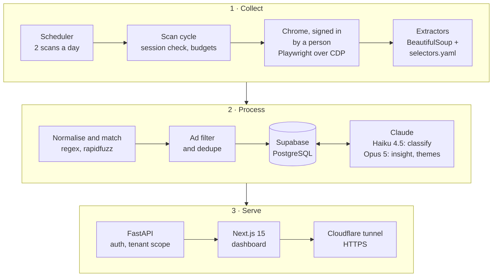
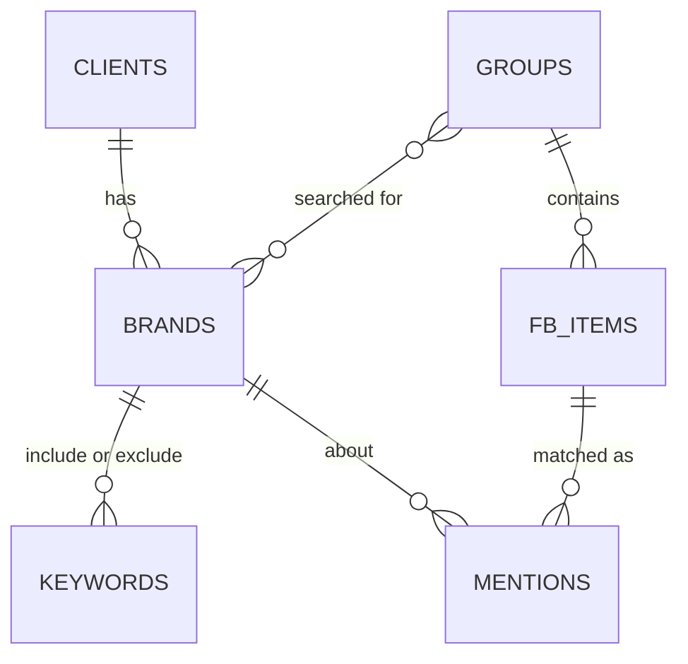

# Sunwai سنوائی

**Social listening for Pakistani Facebook groups, in English, Urdu and Roman Urdu.**

> [!NOTE]
> **README-only showcase.** Sunwai was built at [East River Digital](https://eastriverdigital.com) (ERD) and runs in production for ERD's clients, so the source code is private. This repo documents what the system does, how it is built and the numbers it has produced. A live walkthrough is available on request.

## 🧭 Overview

Pakistani customers complain in Facebook groups, not on brand pages. Meta deprecated the Facebook Groups API in January 2024 and removed it from every Graph API version 90 days later, so standard listening tools can't see these conversations.

Sunwai reads the groups the way a member would. It keeps only posts and comments that name a client's brand or a competitor, and Claude scores each one for sentiment, urgency and topic. Every client gets their own dashboard. ERD staff get urgent-mention alerts and weekly report drafts. The name means "a hearing" in Urdu.

| Aspect | Detail |
|---|---|
| **Users** | ERD account teams and their clients in banking, fintech, automotive, food delivery, FMCG and retail |
| **Source** | Facebook groups the monitoring account belongs to, read through feed scans and in-group search |
| **Languages** | English, Urdu script, Roman Urdu and code-mixed text |
| **Output** | Per-client dashboard (Overview, Mentions, Competitors, Themes, Groups), CSV export, weekly PDF report drafts |

## 📊 By the numbers

Figures as of 28 Oct 2026 unless noted.

| Metric | Value |
|---|---|
| Client workspaces | 15 |
| Brands tracked, own and competitor | 46 |
| Facebook groups monitored | 121 (Nov 2026) |
| Posts captured | 1,909 |
| Classified mentions | 3,814 |
| Posts read that never reach the LLM | ~80%, dropped by the local keyword matcher |
| Anthropic API spend, busy month for one bank | Under $1 |
| Automated tests | 459+, run offline |

## 🏗️ Architecture

Every scan runs three stages: collect, process, serve. Two rules shape the design:

1. **The scraper never logs in.** It attaches to a Chrome session that a person signed into, so no Facebook password exists anywhere in the system.
2. **No page load waits on a model.** Insights and themes are written at the end of each scan cycle and read back from the database.

**One scan cycle:** check session → scan each group (feed + search) → match → store → resolve dates → classify with Haiku → alert on urgent → insight and themes with Opus

## ⚙️ How it works

### 1. Collection

| Piece | What it does | Why |
|---|---|---|
| **Attach over CDP** | Playwright connects to a long-lived Chrome on port 9222 that a person signed into. A Redis lock lets one task drive the account at a time. | No password or 2FA code touches the code. A test asserts there is no password field anywhere. |
| **Two routes in** | A chronological feed scan expands "See more" and comments. In-group search runs each brand keyword, capped at 12 terms per group per day. | The feed is complete for today and is the only route that sees comments. Search adds history and a safety net. |
| **Pure-Python extraction** | Playwright only navigates. The HTML is grabbed once and parsed by pure functions with selectors from a versioned, hot-reloaded `selectors.yaml`. | Fewer DevTools round trips. The same code is unit-tested on saved HTML, and a Facebook layout change is a YAML edit, not a redeploy. |
| **Pacing** | About 250 page loads a day, a 6-hour cap per run, per-group limits and randomised delays. | Page loads, not tokens, are the real budget. They protect the account. |
| **Real post dates** | Reads `creation_time` from Facebook's embedded JSON and merges two record shapes by post id. | Search results carry no date, and every visible date on a post page belongs to a comment. Verified 11/11 exact. |
| **Working links** | Search exposes only a click token, so the matched post is opened in the real browser and the landing URL recorded. Storage refuses non-post URLs. | A mention that can't be opened isn't evidence. |
| **Mock Facebook** | A Flask stand-in whose class names change on every render, with switchable logged-out and checkpoint states. | Development and tests never touch the live site. |

### 2. Matching and filtering

This stage decides what gets stored at all. Anything that doesn't match is counted on the scan run and discarded.

| Live search run, 17 Sep 2026 | Count |
|---|---|
| Posts read | 141 |
| Matched a brand keyword | 27 |
| New mentions sent to Claude | 26 |

- **Normalisation** folds case, invisible characters, diacritics and look-alike Urdu letters, so differently typed spellings of a brand hit the same keyword. Hamza and ھ/ہ stay distinct because they change meaning.
- **Matcher** supports exact word (Unicode word boundaries), phrase and fuzzy matching (rapidfuzz ratio ≥ 90, Latin tokens of 5+ letters only). Exclude keywords veto a match. Fuzzy stays off for Urdu because Urdu words share consonant skeletons.
- **Classified-ad filter** drops sale listings before storage. It needs two weak signals or one strong sale phrase, and any complaint word vetoes the drop. Before this filter, 87% of one automotive client's mentions were sale listings.
- **Deduplication** keys on the Facebook post or comment id, falling back to a SHA-256 of group, author, normalised text and the hour.
- **Free rematch** runs a new client's keywords over every post already collected. One bank started with 872 competitor mentions, 804 of which reused existing classifications.

### 3. AI layer

Each model has its own job. Haiku labels thousands of short items cheaply, and Opus writes the two pieces a client actually reads. There is no vector database: retrieval is the keyword matching above.

| Task | Model | How |
|---|---|---|
| **Classify each mention** | Claude Haiku 4.5 | Relevance, sentiment, urgency, topic, intent, language, confidence, a summary of up to 25 words, and reasoning. Batches of 10, one brand per batch, structured outputs against a JSON schema. |
| **AI Insight** | Claude Opus 5 | One analyst paragraph per client for 7, 30, 90 and 365 days and all time. Input figures are fingerprinted, so unchanged input skips the call. Needs 10+ mentions. |
| **Themes** | Claude Opus 5 | Up to 300 recent mentions grouped into labelled clusters. Below 15 mentions the page says "not enough yet". |
| **Keyword suggestions** | Claude | Reads the brand's own website and proposes spellings in English, Urdu script and Roman Urdu. The fetch is SSRF-guarded, and a person approves every suggestion. |

- 🛡️ A failed or truncated item stays `pending` and is retried next cycle. Sentiment is never guessed.
- 🏷️ Every mention stores the prompt version that produced it (currently `v5`).
- 🎯 Haiku is scored against an Opus-labelled reference set, broken down by language, plus about 25 human-checked items. Only the human-checked set counts as accuracy, because two models can be wrong the same way.
- ✍️ Staff can override any classification, and every override is logged.

### 4. Platform

| Area | Implementation |
|---|---|
| **Auth** | Four roles, argon2 hashes, JWT access and refresh tokens in httpOnly cookies, 15-minute lockout after 10 failed logins |
| **Tenant isolation** | Every query goes through one `scope_to_tenant()` function that fails closed. Tests assert 403 on other tenants' endpoints. |
| **Session health** | A state machine tracks the Facebook session (connected, logged out, checkpoint, restricted, rate limited, unreachable, reconnecting). Planned gaps are recorded silently; unplanned gaps alert, with escalating reminders. |
| **Reconnect** | An admin opens the real browser's screen inside the dashboard (VNC over an authenticated WebSocket, 15-minute one-time token) and signs in by hand. |
| **Urgent alerts** | Negative, high-urgency mentions of a client's own brand alert ERD staff. Competitor mentions never alert. |
| **Reports** | A weekly draft per brand, HTML rendered to PDF in Chromium so Urdu shapes correctly, plus CSV. Nothing is sent without approval. |
| **Audit** | Append-only audit log, plus tokens and cost per run in Admin |
| **Exposure** | Every service binds to 127.0.0.1. The only way in is an HTTPS Cloudflare tunnel. |

### 5. Data model

PostgreSQL on Supabase: 20 tables, 11 hand-written Alembic migrations. A mention is one item matched to one brand, so a post naming two banks becomes two mentions.

🔒 **Privacy:** only keyword-matched items are stored, and authors are kept as display names only (no profile URL, photo or user id). Non-matching posts are kept as pointers (id, link, time) so later comments can be rechecked without storing any text.

### 6. Dashboard

- Next.js 15 server components read the API directly, so there is no client cache to keep in sync.
- Filters live in the URL, so every filtered view is a shareable link.
- Charts are hand-built SVG. Sentiment colours differ in lightness so colour-blind users can tell them apart.
- Text direction follows the script: Urdu renders right to left in Noto Naskh Arabic, Roman Urdu stays left to right.

## ⚖️ Engineering decisions

| Decision | Chose | Over | Why |
|---|---|---|---|
| Data access | One supervised, signed-in browser | Meta Graph API | Group content is no longer available through the API |
| Retrieval | Deterministic keyword matching | Embeddings, or an LLM on every post | Brand names need exact matches, and an LLM on everything costs 10 to 100× more |
| Models | Haiku for labels, Opus for two paragraphs a cycle | Opus for everything | 15 to 25× the cost for labels Haiku already gets right |
| JSON output | Structured outputs + Pydantic validation | "Respond only in JSON" + repair loop | Removes malformed replies as a failure class |
| Insight timing | Written after each cycle, stored | Generated on page load | Pages never wait on the API, and identical input is never paid for twice |
| Themes | Opus clustering with readable labels | k-means or HDBSCAN on embeddings | Labels a client understands, no per-client tuning |
| Framework | Plain Anthropic SDK | LangChain | Two calls, and the SDK already retries 429 and 5xx errors |
| Database | PostgreSQL | MongoDB, SQLite | Relational data where every chart is a `GROUP BY`; SQLite can't be shared across machines |
| PDF reports | HTML to PDF in Chromium | ReportLab, WeasyPrint | Correct Urdu letter shaping |

## 🐛 Hard problems solved

| Problem | Root cause | Fix and result |
|---|---|---|
| Trend charts plotted the scan schedule; 78% of items had only an estimated date | Search results have no date, and every date on a post page belongs to a comment | Read `creation_time` from the embedded JSON and discard uncertain matches. **11/11 dates exact.** |
| Only 6 of 47 post links worked; 35 opened the Facebook homepage | Search exposes only a click token, which resolves to the site root | Click the token in the real browser and record the landing URL. **Working links 6 → 31 on backfill, junk 35 → 0, 8/8 on new runs.** |
| The dashboard crashed during every scan (`EMAXCONNSESSION`, 27 times in one day) | Supabase's session pooler allows 15 connections; the API holds up to 10 and a batch script could take 15 | Batch scripts use `NullPool`, since they run a few queries between minutes of browser work |
| 87% of one automotive client's mentions were car-sale ads | A listing really is about the brand, so the relevance check passed it | A rule-based ad filter before storage, with complaint words as a veto |
| The AI Insight card went blank after moving to Opus 5 | Opus thinks by default, and `max_tokens` covers thinking and answer together; the JSON was cut off at 900 tokens | Raised to 8,000 (insight) and 32,000 (themes), and `stop_reason` is checked on every call |
| Search found 141 posts and stored 0 | The extractor required a timestamp that search results don't have | Keep undated posts, flag the date as estimated, resolve it later. **0 → 141 posts, 26 new mentions.** |
| After a Next.js 16 upgrade the build was clean but no button worked | Turbopack became the default and the app didn't hydrate | Rolled back to 15.x; deploys now assert hydration with a real click |

## 🛠️ Tech stack

| Layer | Technology |
|---|---|
| **Languages** | Python 3.12 (async), TypeScript (strict) |
| **API** | FastAPI, Uvicorn, Pydantic 2 |
| **Database** | PostgreSQL on Supabase, SQLAlchemy 2 (asyncpg), Alembic |
| **Collection** | Playwright over CDP, BeautifulSoup, hot-reloaded YAML selectors |
| **Matching** | Unicode-aware regex, rapidfuzz |
| **AI** | Claude Haiku 4.5 (classification), Claude Opus 5 (insights, themes) |
| **Dashboard** | Next.js 15 App Router, React 19, Tailwind CSS 3.4, hand-built SVG charts |
| **Auth** | argon2, PyJWT in httpOnly cookies |
| **Scheduling** | systemd timers in production, Redis lock per account |
| **Reports and email** | HTML to PDF via Chromium, Resend |
| **Ops** | Cloudflare tunnel, structlog, Docker Compose for development |
| **Testing** | pytest (459+ tests), ruff, mypy strict, Flask mock of Facebook |

## 🖼️ Screenshots

### Client dashboard

What a client sees. Business and group names are blurred.

<table>
  <tr>
    <td width="51%" align="center" valign="top">
      
       Overview: volume, need-attention count, negative share, sentiment, urgency and topics
    </td>
    <td width="49%" align="center" valign="top">
      
       Competitors: share of conversation per rival, split by sentiment
    </td>
  </tr>
  <tr>
    <td width="49%" align="center" valign="top">
      
       Overview filtered to a single business
    </td>
    <td width="51%" align="center" valign="top">
      
       Themes: recurring topics clustered and labelled by Claude Opus
    </td>
  </tr>
  <tr>
    <td colspan="2" align="center" valign="top">
      
       Mentions: scanner activity, needs-action triage, filters and the detail panel
    </td>
  </tr>
</table>

### Internal tools (ERD staff only)

<table>
  <tr>
    <td width="50%" align="center" valign="top">
      
       Groups: add a Facebook group, choose which brands to search in it
    </td>
    <td width="50%" align="center" valign="top">
      
       Admin: brands, include and exclude keywords, AI keyword suggestions
    </td>
  </tr>
  <tr>
    <td width="50%" align="center" valign="top">
      
       Facebook Session: health check on the logged-in browser
    </td>
    <td width="50%" align="center" valign="top">
      
       Scanner Management: daily scan times and scheduler status
    </td>
  </tr>
</table>

## ⚠️ Limitations

| Limit | Detail |
|---|---|
| **Platform risk** | Facebook's terms don't allow automated collection. Exposure is limited to one real member account, about 250 page loads a day, no stored passwords and only brand-matching content kept. |
| **One monitoring account** | If its session can't be renewed, collection stops until an admin reconnects it. |
| **Layout changes** | A Facebook markup change needs a selector update (a YAML edit, no redeploy). |
| **Duplicates** | About 3% of items were stored under two ids, which slightly overstates volume. |
| **Email alerts** | Built end to end, but off until the sending domain is verified. |
| **Sentiment** | A signal, not a verdict. That's why every classification can be overridden. |

## 🗺️ Roadmap

- [ ] Verify the email domain and switch on urgent alerts
- [ ] Content-based dedupe and a one-off cleanup of existing duplicates
- [ ] Database reconnect inside long scans
- [ ] Move the LinkedIn collector out of beta (81 mentions so far) and into the main feed
- [ ] More monitoring accounts and a job queue, so collection scales past one account's page-load budget

## 📬 Contact

**Adeel Iqbal**

- 📧 Email: [adeelmemon096@yahoo.com](mailto:adeelmemon096@yahoo.com)
- 💼 LinkedIn: [linkedin.com/in/adeeliqbalmemon](https://linkedin.com/in/adeeliqbalmemon)
- 🐙 GitHub: [@adeel-iqbal](https://github.com/adeel-iqbal)
